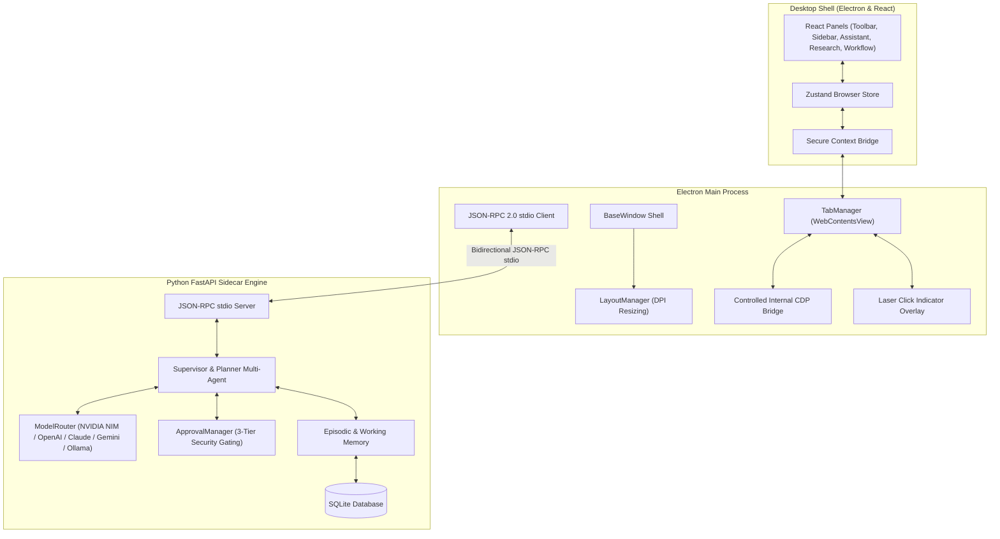

# AI Browser

<p align="center">
  
  
  
  
  
  
  
</p>

An autonomous, production-grade AI desktop browser inspired by the user experience of Perplexity Comet. Combines full Chromium browsing with an integrated multi-agent intelligence system capable of real-time page perception, cited multi-tab research, visual DOM interaction, and multi-step autonomous task execution.

---

## 🌟 Key Features

### 🧠 Dual-Mode Agentic AI (Perplexity Comet Parity)
- **Mode A (Ambient Co-Browse & Research)**: Real-time understanding of active tabs, multi-tab cross examination, multi-hop deep research, and rich markdown synthesis with interactive citation pills `[1]`, `[2]`.
- **Mode B (Autonomous Operator)**: Translates natural language goals into multi-step execution plans with deterministic selector matching, fallback centroid clicks, self-healing replanning, and verification.

### 👁️ High-Speed Multimodal Perception
- **CDP DOM Bridge**: Captures deterministic CSS selectors (`#id` > `[data-testid]` > `[name]` > `[aria-label]` > `text=...`), element bounding boxes, DPI-scaled coordinates, and clean hierarchy text.
- **Zero-Latency Visual Capture**: Viewport snapshotting with dynamic real-time **Laser Indicator** click ripples for visual operation feedback.

### 🛡️ 3-Tier Human-in-the-Loop (HITL) Security
- **Green Tier (Autonomous)**: Read-only actions (navigation, page inspection, accessibility tree, search).
- **Yellow Tier (Notify & Execute)**: Safe interactions executed with user visibility.
- **Red Tier (Approval Required)**: Financial transactions, checkout actions, passwords/credentials, privileged protocols (`javascript:`, `file:`), and desktop actions require explicit user sign-off with a visual risk-meter dialog.

### 🌐 Universal AI Model Routing
Dynamically route requests across leading AI models based on task type (vision, reasoning, synthesis, code):
- **NVIDIA NIM** (Primary): Nemotron-3.5-Lightning, Llama-3.3-70b-Instruct, Nemotron Super-VL 120B, Mistral Large.
- **OpenAI**: GPT-4o, GPT-4o-mini.
- **Anthropic Claude**: Claude 3.5 Sonnet.
- **Google Gemini**: Gemini 2.0 Flash.
- **Groq**: Llama 3.3 70B Versatile.
- **Ollama**: Local offline inference (`llama3.2`, `llava`).

### ⚡ Workflows, Memory & Desktop Automation
- **Workflow Recorder**: Record, save, and automate repetitive multi-step browser workflows.
- **Deep Research Panel**: Autonomous web search, cross-reference extraction, and structured synthesis.
- **Episodic & Working Memory**: Persistent context retention across browsing sessions.
- **Desktop Automation**: System-level automation with strict approval gates and audit logging.

---

## 🏗️ Architecture



---

## 📁 Project Structure

```
AI-Browser/
├── apps/
│   └── desktop/                  # Electron BaseWindow shell + React 18 / Vite UI
│       ├── electron/             # Main process controllers & bridge
│       │   ├── browser/          # TabManager, PageObserver, PageActions, WorkflowRecorder
│       │   ├── bridge/           # IPC handlers & JSON-RPC stdio client
│       │   └── layout-manager.ts # Responsive BaseWindow & WebContentsView layout
│       ├── src/                  # React panels & components
│       │   ├── panels/           # AssistantPanel, ToolbarPanel, SidebarPanel
│       │   ├── components/       # ApprovalDialog, ResearchPanel, WorkflowPanel, SettingsView
│       │   ├── overlay/          # LaserIndicator click ripple visualizer
│       │   └── store/            # Zustand browser state management
│       └── tests/                # Vitest unit tests & smoke tests
├── backend/                      # Python 3.11 FastAPI autonomous agent engine
│   ├── app/
│   │   ├── agents/               # Supervisor, Planner, BrowserAgent, Researcher, DataAgent
│   │   ├── ai/                   # Multi-provider registry & ModelRouter (NIM, OpenAI, Claude, Gemini, Groq, Ollama)
│   │   ├── automation/           # Desktop process execution & audit logger
│   │   ├── browser/              # Bridge communication & CDP tools
│   │   ├── memory/               # Episodic & working memory service
│   │   ├── research/             # Multi-hop deep research orchestrator
│   │   ├── scheduler/            # Background tasks & automation scheduler
│   │   ├── security/             # 3-tier HITL ApprovalManager
│   │   ├── workflows/            # Workflow execution & replay engine
│   │   └── database/             # SQLAlchemy async models & repository
│   └── tests/                    # Pytest test suites (33 comprehensive tests)
├── shared/                       # Shared TypeScript contracts, IPC channels & RPC definitions
├── scripts/                      # Build, dev & packaging scripts
├── docs/                         # Architecture, Security, API & Development specs
├── .env.example                  # Environment configuration template
└── AGENTIC_BROWSER_SPEC.md       # Agentic browser implementation blueprint
```

---

## 🚀 Getting Started

### Prerequisites

- **Node.js**: `v20.x` or `v22.x`+ (Node v24 recommended)
- **Python**: `3.11+`
- **uv** (recommended for ultra-fast Python package management) or `pip`

### Installation & Setup

1. **Clone the repository**:
   ```bash
   git clone https://github.com/sagarsahni6/AI-Browser.git
   cd AI-Browser
   ```

2. **Configure Environment Variables**:
   ```bash
   cp .env.example .env
   ```
   Add your API key (e.g. `NVIDIA_API_KEY`, `OPENAI_API_KEY`, `ANTHROPIC_API_KEY`, or `GOOGLE_API_KEY`) to `.env`.

3. **Install JavaScript dependencies**:
   ```bash
   npm install
   ```

4. **Setup Python Virtual Environment**:
   ```bash
   # Using uv (recommended)
   uv venv backend/.venv
   uv pip install -r backend/requirements.txt --python backend/.venv/Scripts/python.exe

   # Or using standard python venv
   python -m venv backend/.venv
   backend\.venv\Scripts\pip install -r backend/requirements.txt
   ```

---

## 🧪 Running Tests

Verify that all subsystems (frontend, backend, type safety) are working properly:

```bash
# 1. Desktop UI tests (Vitest)
npm run desktop:test

# 2. TypeScript compilation check
npx tsc --noEmit -p apps/desktop/tsconfig.json

# 3. Backend tests (Pytest - 33 test suite)
npm run backend:test
```

---

## 🖥️ Running Development Mode

Launch the Electron shell and FastAPI backend sidecar together:

```bash
npm run desktop:dev
```

---

## 🔒 Security Principles

- **No Exposed Remote Debugging Port**: CDP is controlled strictly in-process through Electron's internal debugging protocol; no network ports are left open.
- **Sandboxed Web Views**: Web pages execute inside isolated `WebContentsView` instances with `nodeIntegration: false`, `contextIsolation: true`, and `sandbox: true`.
- **Zero Token Leakage**: Credentials and secret tokens are kept server-side or in secure storage and never exposed to web contexts.
- **Human-in-the-Loop (HITL)**: Destructive actions, system calls, and credential submissions are blocked until explicit user confirmation.

---

## 📄 License

Distributed under the MIT License.
